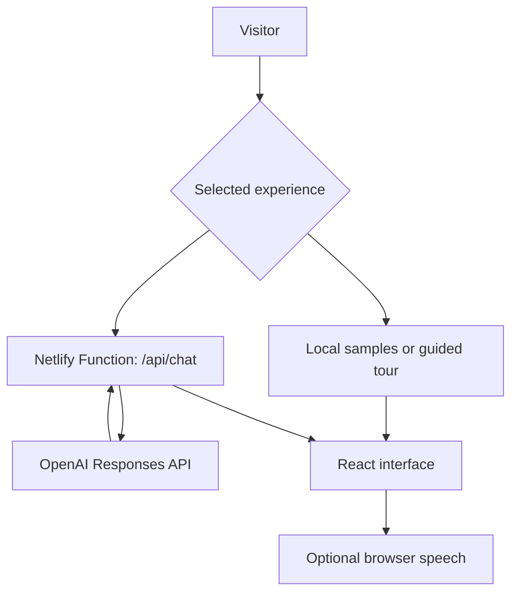

<a id="top"></a>

<p align="center">
  
</p>

<div align="center">

# NEXA · Public AI Experience

**Ask. Speak. Practise. Explore.**

A conversational AI website and engineering case study by **Yasmeen Azmat Ali**.

[](https://nexa-public.netlify.app/)
[](https://github.com/yasmeenmh90-beep/nexa-ai-operations-assistant)


[Experience](#experience) · [Quick start](#quick-start) · [Architecture](#architecture) · [Deployment](#deployment) · [Validation](#validation) · [Documentation](#documentation)

</div>

---

> [!NOTE]
> **This repository contains the runnable public website.** It is separate from the private NEXA assistant and its n8n workflow foundation. Public visitors cannot access personal email, calendars, private repositories or personal memory.

<table>
<tr>
<td width="50%">
<h3>01 · Try the experience</h3>
<p>Explore fictional productivity samples, ask general AI questions, use browser voice and practise technical interviews.</p>
<p><a href="https://nexa-public.netlify.app/"><strong>Open NEXA ↗</strong></a></p>
</td>
<td width="50%">
<h3>02 · Explore the engineering</h3>
<p>Review the implementation, request controls, public/private boundaries and clearly scoped testing evidence.</p>
<p><a href="https://github.com/yasmeenmh90-beep/nexa-ai-operations-assistant"><strong>Read the case study ↗</strong></a></p>
</td>
</tr>
</table>

<a id="experience"></a>

## 01 · The experience

| Feature | What visitors can do | How it works |
| :--- | :--- | :--- |
| **Sample Demo** | Preview Daily Briefing, Inbox, Calendar, Projects, Career and GitHub tasks | Six fictional, predefined browser-local summaries; no OpenAI request |
| **Live AI** | Ask general questions and continue with follow-ups | Server-side OpenAI requests with bounded recent conversation context |
| **Browser voice** | Dictate a message and listen to replies | Browser speech recognition and synthesis; review dictated text before Send |
| **Interview Practice** | Choose AI/ML, full-stack or backend at beginner/intermediate level | AI-generated questions and constructive feedback; educational practice |
| **Guided tour** | Explore the interface with Back, Next and Finish | Six local steps; no AI requests |
| **Visitor tools** | Choose suggested prompts, copy answers and open feedback drafts | Copy feedback and prefilled public GitHub issue drafts |

The interface brings these features into an editorial hero and compact chat studio, with architecture cards, FAQ, responsive navigation and an expandable prototype gallery.

**Voice in motion:** the existing NEXA portrait uses a glowing halo, animated bars and subtle movement during speech. Decorative motion includes reduced-motion styles. Precise word-matched lip sync is not implemented.

<details>
<summary><strong>A quick walkthrough</strong></summary>

1. Open the [live website](https://nexa-public.netlify.app/) and try **Daily Briefing** in Sample Demo.
2. Switch to **Live AI** and ask: “Explain an API in two sentences.”
3. Follow up with: “Give me an everyday example.”
4. In a supported browser, allow the microphone, dictate a question, review it and press **Send**.
5. Enable spoken replies or use **Read aloud**.
6. Choose **Interview Practice**, select a track and level, then start practice and answer a question.
7. Open **Take a guided tour** for a local introduction.

Interview feedback is AI-generated guidance, not a validated score or hiring prediction. Changing track, level or experience resets recent context.

</details>

<a id="architecture"></a>

## 02 · Architecture & boundaries



| Layer | Responsibility |
| :--- | :--- |
| **React + TypeScript** | Conversational interface, experience selection and bounded in-memory follow-ups |
| **Vite + Tailwind CSS** | Frontend build, layout and visual styling |
| **Browser speech APIs** | Microphone transcription and spoken replies where supported |
| **Netlify Function** | Request validation, feature switch, configured throttling and OpenAI access |
| **OpenAI Responses API** | General answers and interview practice using `gpt-4.1-mini` |

> [!IMPORTANT]
> There is no public-to-private n8n request path. Sample tasks are fictional, and Live AI has no personal project catalogue. Origin checks are not authentication. AI answers may be inaccurate.

<details>
<summary><strong>Conversation, speech and feedback behavior</strong></summary>

- Follow-ups include up to **three recent completed exchanges**: six alternating user/assistant messages, at most 2,000 characters each and 6,000 characters total.
- Resetting, changing modes or refreshing clears browser-held context. Chats are not persisted to browser storage or an application database.
- Live requests send the current message and permitted history to OpenAI. Browser recognition may use the browser provider’s speech service.
- Voice support, available voices and audio permissions depend on the browser.
- Feedback links open prefilled **public GitHub issue drafts**. No conversation is automatically attached; submitting requires a GitHub account.
- The gallery shows an earlier dashboard prototype, rather than every current public feature.

</details>

<a id="quick-start"></a>

## 03 · Run locally

**Prerequisites:** Node.js **22** and npm.

```bash
git clone https://github.com/yasmeenmh90-beep/nexa-public.git
cd nexa-public
npm ci
npm run dev
```

Open the local URL printed by Vite.

| Command | Purpose |
| :--- | :--- |
| `npm run dev` | Start the frontend development server |
| `npm run typecheck` | Check TypeScript |
| `npm run build` | Type-check and create the production bundle in `dist` |
| `npm run preview` | Preview the frontend production bundle |
| `node --test tests/chat.test.mjs` | Run the mocked backend tests |

> [!TIP]
> Vite serves the frontend, local samples and guided tour. **Live AI requires the Netlify Function**, its environment variables and an allowed request origin. The current handler allows the deployed public origin only; a local Netlify setup also needs an explicit development-origin configuration.

<a id="deployment"></a>

## 04 · Deploy with Netlify

The repository is connected to Netlify. Its production branch uses [`netlify.toml`](netlify.toml):

| Setting | Value |
| :--- | :--- |
| Node.js | `22` |
| Build command | `npm run build` |
| Publish directory | `dist` |
| Functions directory | `netlify/functions` |

Configure these variables **server-side in Netlify**:

| Variable | Purpose |
| :--- | :--- |
| `OPENAI_API_KEY` | OpenAI project API key used by the function |
| `NEXA_LIVE_CHAT_ENABLED` | Set to `true` to enable Live AI; other values disable it |

Never place the API key in browser code, a `VITE_*` variable, a public file, screenshot or issue. Environment changes must reach the deployed function.

**Deployment workflow:** batch related edits into one commit, review the build, then smoke-test the deployed site. A frontend-only `dist` upload does not configure the backend function; do not upload source folders or `node_modules` through Netlify Drop.

<details>
<summary><strong>Change the hostname, metadata or public links</strong></summary>

Canonical metadata, Open Graph image URL, `robots.txt` and `sitemap.xml` currently target `https://nexa-public.netlify.app`.

For a new hostname:

```bash
npm run set-site-url -- https://YOUR-FINAL-PUBLIC-HOSTNAME
npm run build
```

Also update the permitted request origin in [`netlify/functions/chat.mjs`](netlify/functions/chat.mjs).

Public links are configured in [`src/config/publicLinks.ts`](src/config/publicLinks.ts). Booking and demo-video links are optional. Only publish a recording containing public demonstration content.

</details>

<a id="controls"></a>

## 05 · Request controls & costs

| Control | Current implementation |
| :--- | :--- |
| Request | `POST` JSON from the configured public origin |
| Message | 1–1,500 characters |
| Body size | At most 48,000 bytes |
| History | Six alternating messages; 2,000 characters each; 6,000 total |
| Roles | User/assistant history only; system/developer roles rejected |
| Upstream timeout | 20 seconds |
| Output | At most 400 requested output tokens |
| Rate-limit configuration | 5 requests per 60 seconds per IP/domain grouping |

Follow-up context increases input-token use. **Netlify usage and OpenAI API usage are separate.** Per-IP throttling is not a global spending cap; check account-level usage and budget controls separately. This repository cannot verify account settings or guarantee a maximum bill.

To disable Live AI, set `NEXA_LIVE_CHAT_ENABLED=false` and deploy that change. Local samples remain available.

<a id="structure"></a>

## 06 · Source map

| File | Responsibility |
| :--- | :--- |
| [`src/App.tsx`](src/App.tsx) | Page content, architecture, portrait, gallery and guided introduction |
| [`src/components/VoiceChat.tsx`](src/components/VoiceChat.tsx) | Sample/live experiences, interview controls, voice and request cancellation |
| [`src/hooks/useVoice.ts`](src/hooks/useVoice.ts) | Speech recognition and synthesis lifecycle |
| [`src/styles.css`](src/styles.css) | Layout, speaking visuals, responsive and reduced-motion styles |
| [`src/config/publicLinks.ts`](src/config/publicLinks.ts) | Public destination links |
| [`netlify/functions/chat.mjs`](netlify/functions/chat.mjs) | Server-side OpenAI request handling |
| [`tests/chat.test.mjs`](tests/chat.test.mjs) | Mocked backend regression coverage |
| [`scripts/set-site-url.mjs`](scripts/set-site-url.mjs) | Deployment metadata configuration |

<a id="validation"></a>

## 07 · Validation & next steps

**Recorded engineering checks:** TypeScript compilation, a Vite production build, ten mocked backend tests and static rendered-HTML checks passed for the documented public update. These are previously recorded results; this README edit does not rerun application checks.

**Owner-reported device checks:** microphone transcription, Live AI answers and spoken replies worked on the deployed website.

Backend tests mock OpenAI. They do not validate live model quality, clipboard permissions, microphone behavior or complete browser accessibility. Browser preview was unavailable during the documented visual update; no complete security audit is claimed.

| Next verification | Scope |
| :--- | :--- |
| **Mobile & accessibility** | Current phone/tablet layouts, keyboard navigation, dialog focus, contrast and reduced motion |
| **Interview flow** | Full question → answer → feedback → next-question cycle and answer quality |
| **Deployment & dependencies** | Latest build result, dependency review and account spending controls |
| **Demonstration evidence** | Review and publish a clean walkthrough of current features |

Private authentication, personal-service integration and precise lip sync remain separate future work. Historical source-recovery and n8n verification statements are attributed to the owner.

<a id="documentation"></a>

## 08 · Explore the documentation

| Document | Read it for |
| :--- | :--- |
| [**Project overview**](https://github.com/yasmeenmh90-beep/nexa-ai-operations-assistant/blob/main/README.md) | Product scope, capabilities and public/private boundaries |
| [**Testing & evidence**](https://github.com/yasmeenmh90-beep/nexa-ai-operations-assistant/blob/main/NEXA_TESTING_REPORT.md) | Current checks, evidence limits and historical results |
| [**Workflow atlas**](https://github.com/yasmeenmh90-beep/nexa-ai-operations-assistant/blob/main/NEXA_WORKFLOWS.md) | 18 separate n8n workflow definitions and screenshot references |
| [**Development roadmap**](https://github.com/yasmeenmh90-beep/nexa-ai-operations-assistant/blob/main/NEXT_CASE_STUDY_PLAN.md) | Public validation priorities and future private integration |

---

<div align="center">

**Built by Yasmeen Azmat Ali**

[Try NEXA ↗](https://nexa-public.netlify.app/) · [Engineering documentation ↗](https://github.com/yasmeenmh90-beep/nexa-ai-operations-assistant) · [Report a problem](https://github.com/yasmeenmh90-beep/nexa-public/issues/new) · [Back to top ↑](#top)

<sub>PUBLIC AI EXPERIENCE · REACT + TYPESCRIPT · DOCUMENTATION UPDATED 15 OCTOBER 2026</sub>

</div>
